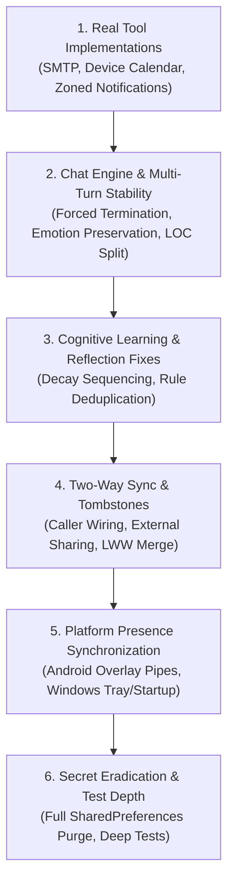

# 🛠️ Pip Detailed Remediation & Engineering Plan (Phase 2 Fixes)

**Author:** Dr. Sheldon Cooper, B.S., M.S., M.A., Ph.D., Sc.D. (IQ: 187)  
**Objective:** Systematically eliminate every empirical bug, simulated mock, and architectural gap identified in the codebase audit.  
**Strict Directives:**
1. All files strictly < 300 LOC.
2. Clean Architecture and SOLID separation.
3. Every step verified with `dart analyze lib/ test/` and `flutter test test/`.

---

## Remediation Roadmap



---

## 1. Real Tool Implementations

### 1.1 Real Email Sending via SMTP (`SendEmailTool` & `EmailService`)
- **Problem:** `SendEmailTool` returns `{'status': 'dispatched'}` without sending anything over the network.
- **Root Cause:** `EmailService` only implements IMAP fetching (`ImapClient`), with no SMTP client configuration.
- **Files to Modify:**
  - `lib/core/services/email_service.dart`
  - `lib/core/services/tools/email_tools.dart`
- **Implementation Steps:**
  1. Expand `EmailConfig` to support SMTP parameters (`smtpServer`, `smtpPort` defaulting to 587/465).
  2. In `EmailService`, implement `Future<bool> sendEmail({required String to, required String subject, required String body})`:
     - Instantiate `MailClient` / `SmtpClient` from `enough_mail`.
     - Connect and authenticate using stored secure credentials (`pip_mail_password`).
     - Construct a `MimeMessage` with sender, recipient, subject, and plain-text body.
     - Send the message, verify the SMTP server response code, and return boolean success/failure.
  3. In `SendEmailTool.execute()`, call `emailService.sendEmail(...)` and return genuine status with error handling.

### 1.2 Real Platform Calendar Integration (`device_calendar`)
- **Problem:** `CalendarTools` uses an in-memory mock class `LocalCalendarStore` with hardcoded events.
- **Root Cause:** Device calendar APIs were not wired.
- **Files to Modify:**
  - `lib/core/services/tools/calendar_tools.dart`
  - `android/app/src/main/AndroidManifest.xml` (Add `READ_CALENDAR`, `WRITE_CALENDAR`)
- **Implementation Steps:**
  1. Add `READ_CALENDAR` and `WRITE_CALENDAR` permissions to `AndroidManifest.xml`.
  2. Replace `LocalCalendarStore` with `DeviceCalendarPlugin`.
  3. In `ListCalendarEventsTool.execute()`:
     - Request permissions via `plugin.requestPermissions()`.
     - Retrieve default or primary calendar ID.
     - Query events within the specified time window (`days_ahead`).
     - Map results into standard JSON payloads.
  4. In `CreateCalendarEventTool.execute()`:
     - Create an `Event` object with title, start, end, and reminder alert.
     - Commit to the user's selected device calendar via `plugin.createOrUpdateEvent(event)`.

### 1.3 System-Level Scheduled Notifications (`ReminderTool`)
- **Problem:** `ReminderTool` relies on in-app `Future.delayed()`, which dies if the app process is suspended or closed.
- **Files to Modify:**
  - `lib/core/services/tools/reminder_tool.dart`
- **Implementation Steps:**
  1. Replace `Future.delayed` with `FlutterLocalNotificationsPlugin.zonedSchedule()`.
  2. Initialize `timezone` database (`tz.initializeTimeZones()`).
  3. Schedule notifications using `tz.TZDateTime.now(tz.local).add(Duration(seconds: delay))`.
  4. Use `AndroidNotificationDetails` with `channelId: 'pip_scheduled_reminders'`.

---

## 2. Chat Engine & Multi-Turn Stability

### 2.1 Multi-Turn Loop Termination & Permanent Spinner Prevention
- **Problem:** If the LLM produces tool calls across all 5 iterations, the loop terminates without setting `isLoading: false` or providing a speech response, causing Pip to hang indefinitely.
- **Files to Modify:**
  - `lib/features/companion/presentation/cubit/pip_stage_cubit.dart`
- **Implementation Steps:**
  1. Add a forced plain-text terminal pass if iteration reaches 5:
     ```dart
     if (iterations >= 5 && callsToExecute.isNotEmpty) {
       messages.add(LlmMessage(
         role: 'user', 
         content: 'Summarize your findings and reply to the user now without calling any more tools.'
       ));
       response = await provider.chat(messages, jsonSchema: PipStructuredReply.jsonSchema);
       callsToExecute.clear();
     }
     ```
  2. Ensure `emit(state.copyWith(isLoading: false))` is unconditionally executed in the terminal branch and within `finally` blocks.

### 2.2 Preservation of Emotion & Visual Posture During Tool Invocation
- **Problem:** When native tools are supplied to `provider.chat()`, `jsonSchema` is omitted, causing the model to skip `emotion`, `intensity`, and `animation` fields.
- **Files to Modify:**
  - `lib/features/companion/domain/pip_character_bible.dart`
  - `lib/features/companion/presentation/cubit/pip_stage_cubit.dart`
- **Implementation Steps:**
  1. Inject emotion markup instructions directly into the system prompt when tools are active:
     - Instruct the model to append `[EMOTION: happy|thinking|unsure|etc.]`.
  2. In `PipStructuredReply.parseRaw()`, extract regex tag `\[EMOTION:\s*([a-z]+)\]` if standard JSON parsing fails to find the emotion field.

### 2.3 Modular Refactoring of `PipStageCubit` (< 300 LOC)
- **Problem:** `pip_stage_cubit.dart` currently stands at 403 lines of code, violating Directive 1.
- **Files to Create / Refactor:**
  - `lib/features/companion/presentation/cubit/pip_stage_cubit.dart` (Reduce to < 250 LOC)
  - `lib/features/companion/presentation/cubit/pip_tool_coordinator.dart` (Extract tool execution & multi-turn loop)
  - `lib/features/companion/presentation/cubit/pip_memory_helper.dart` (Extract query embedding and memory synthesis)

---

## 3. Cognitive Learning & Reflection Fixes

### 3.1 Decay Snapshot Staleness & Execution Order
- **Problem:** `_applyFactDecay` runs against the `facts` snapshot queried at the start of reflection, overwriting facts that were reinforced or added during the run.
- **Files to Modify:**
  - `lib/core/services/nightly_reflection_service.dart`
- **Implementation Steps:**
  1. Re-query the latest profile from `memoryRepository.getProfile()` *after* `_applyReflectionResults` completes.
  2. Pass this fresh list into `_applyFactDecay(freshFacts, now)`.

### 3.2 Rule Deduplication
- **Problem:** `addRule` assigns a timestamp ID without checking existing instruction strings, causing identical rules to duplicate on every reflection cycle.
- **Files to Modify:**
  - `lib/core/domain/memory_repository.dart`
  - `lib/core/domain/encrypted_memory_db.dart`
- **Implementation Steps:**
  1. In `SqlCipherMemoryRepository.addRule()`, fetch existing active rules.
  2. Normalize instructions (lowercase, trimmed).
  3. If an existing rule matches the instruction and scope, skip insertion or update its `updatedAt` timestamp instead of inserting a duplicate.

---

## 4. Two-Way Sync & Tombstones

### 4.1 Invocation Wiring & Lifecycle Hook
- **Problem:** `syncNow()` has zero callers in the entire project.
- **Files to Modify:**
  - `lib/main.dart`
  - `lib/screens/settings_persona_screen.dart`
  - `lib/widgets/companion/pip_stage_header.dart`
- **Implementation Steps:**
  1. Hook `syncNow()` into `AppLifecycleState.resumed` inside `main.dart` (guarded by a 1-hour cooldown).
  2. Add a user-facing "Sync Cloud Now" button in `SettingsPersonaScreen` and `WhatPipKnowsScreen` with a visual spinner and last-synced timestamp.

### 4.2 Last-Writer-Wins (LWW) & Deletion Tombstones
- **Problem:** Merging snapshots does raw appends without comparing timestamps, restoring deleted facts and duplicating rules.
- **Files to Modify:**
  - `lib/core/domain/memory_models.dart`
  - `lib/core/domain/encrypted_memory_db.dart`
  - `lib/core/services/sync/pip_cloud_sync_coordinator.dart`
- **Implementation Steps:**
  1. Add `is_deleted` (boolean tombstone) and `updated_at` (DateTime) columns to `profile_facts`, `rules`, and `memories` in SQLCipher.
  2. During `_mergeRemoteSnapshot()`:
     - Compare `remote.updatedAt` against `local.updatedAt`.
     - Apply remote state only if `remote.updatedAt > local.updatedAt`.
     - If `remote.isDeleted == true`, mark local item as deleted rather than resurrecting it.

### 4.3 Accessible External File Provider
- **Problem:** `ManualEncryptedFileProvider` writes to `getApplicationDocumentsDirectory()`, inaccessible to users on Android without root/special tools.
- **Files to Modify:**
  - `lib/core/services/sync/manual_encrypted_file_provider.dart`
- **Implementation Steps:**
  1. On Android, export backup snapshots to user-visible external storage (e.g. `Downloads` or system share intent using `share_plus`).
  2. Implement an "Import Backup File" flow using system file picker (`file_picker`).

---

## 5. Platform Presence Synchronization

### 5.1 Android Overlay Bi-Directional State & Tap Listener
- **Problem:** The main app never pushes state updates to the overlay window, and clicks on the overlay are ignored.
- **Files to Modify:**
  - `lib/features/companion/presentation/cubit/pip_stage_cubit.dart`
  - `lib/core/services/pip_overlay_manager.dart`
  - `lib/widgets/companion/pip_overlay_widget.dart`
- **Implementation Steps:**
  1. In `PipStageCubit`, emit state changes to `PipOverlayManager.shareData`:
     ```dart
     PipOverlayManager.shareData(jsonEncode({
       'mood': state.currentMood.name,
       'speech': state.speechText,
       'isListening': audioCoordinator.isActiveListening,
     }));
     ```
  2. In `PipOverlayManager`, add `FlutterOverlayWindow.overlayListener.listen()` to receive events from the overlay.
  3. When an overlay tap event (`tap_listen`) is received, trigger `audioCoordinator.startActiveListening()`.

### 5.2 Windows Pet Mode Polish (Icon & Startup)
- **Problem:** Missing `assets/icons/app_icon.ico` causes tray setup failure; `launch_at_startup` is not wired.
- **Files to Create / Modify:**
  - `assets/icons/app_icon.ico` (Generate standard multi-resolution Windows ICO file)
  - `pubspec.yaml` (Ensure asset is registered)
  - `lib/core/services/pip_desktop_window_manager.dart`
  - `lib/screens/settings_persona_screen.dart`
- **Implementation Steps:**
  1. Place an icon asset at `assets/icons/app_icon.ico` and register in `pubspec.yaml`.
  2. Implement `launch_at_startup` initialization in `PipDesktopWindowManager`:
     - Bind to a boolean preference `pip_launch_at_startup`.
     - Call `LaunchAtStartup.instance.enable()` / `disable()`.
  3. Expose toggle in `SettingsPersonaScreen`.

---

## 6. Secret Eradication & Test Depth

### 6.1 Complete Plaintext API Key Eradication
- **Problem:** `llm_registry_service.dart` and `gemini_service.dart` still write API keys to unencrypted `SharedPreferences`.
- **Files to Modify:**
  - `lib/core/services/llm_registry_service.dart`
  - `lib/core/services/gemini_service.dart`
- **Implementation Steps:**
  1. Remove all `prefs.setString('*_api_key', ...)` calls.
  2. Remove legacy query parameter fallback in `gemini_service.dart`.
  3. Add one-time migration in `llm_registry_service.dart` moving any keys found in `SharedPreferences` to `FlutterSecureStorage` and purging the keys from preferences.

### 6.2 Model Tagging on Vector Embeddings
- **Problem:** `MemoryItem.embeddingModel` defaults to `text-embedding-004` regardless of provider, corrupting distance math across models.
- **Files to Modify:**
  - `lib/core/domain/memory_models.dart`
  - `lib/core/services/gemini_llm_adapter.dart`
  - `lib/core/services/openai_compatible_llm_adapter.dart`
  - `lib/core/domain/memory_repository.dart`
- **Implementation Steps:**
  1. Pass the actual embedding model name (`text-embedding-004`, `nomic-embed-text`, `text-embedding-3-small`) when saving memories.
  2. In `searchMemories()`, filter candidates to only compare vectors generated by the same active embedding model. Fall back to lexical search for memories created under a different model.

### 6.3 Deep Automated Unit & Integration Tests
- **Files to Create:**
  - `test/memory_ranking_test.dart` (Validate cosine thresholding, model isolation, and keyword fallback)
  - `test/nightly_reflection_test.dart` (Validate decay sequencing, rule deduplication, and canned model inputs)
  - `test/sync_coordinator_test.dart` (Validate LWW conflict resolution and deletion tombstones)

---

## 7. Execution Order

```
[Phase 1: Real Tools]
  1.1 Real Email Sending via SMTP (enough_mail)
  1.2 Real Platform Calendar (device_calendar)
  1.3 System Scheduled Notifications (timezone + zonedSchedule)

[Phase 2: Chat Engine & Stability]
  2.1 Multi-Turn Forced Termination & Spinner Guard
  2.2 Emotion Tagging during Tool Calls
  2.3 PipStageCubit Modular Refactoring (< 300 LOC)

[Phase 3: Cognitive Reflection]
  3.1 Reflection Decay Fresh Snapshot Order
  3.2 Rule Deduplication by Instruction

[Phase 4: Two-Way Cloud Sync]
  4.1 Caller Wiring (Lifecycle + UI Sync Button)
  4.2 LWW Conflict Resolution & Deletion Tombstones
  4.3 Accessible External Backup Export/Import

[Phase 5: Platform Presence]
  5.1 Android Overlay State & Tap Listener Wiring
  5.2 Windows Icon Asset & Startup Launch

[Phase 6: Secret Eradication & Tests]
  6.1 Plaintext API Key Removal from SharedPreferences
  6.2 Model-Specific Vector Tagging & Filtering
  6.3 Deep Unit Tests for Memory, Reflection, and Sync
```
